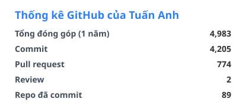

<h1 align="left" id="anhlbt-title">:wave: Xin chào! Mình là Lê Bá Tuấn Anh</h1>
<h3 align="left">Backend / Platform engineer · .NET microservices · orchestration · AI-assisted delivery</h3>

<p align="left">
  <a href="https://github.com/anhlbt3004"></a>
  <a href="https://github.com/anhlbt3004?tab=followers"></a>
</p>

<a href="#anhlbt-title"></a>

- :office: &nbsp;Đang làm tại **ICHIBA**: nền tảng cross-border commerce (OMS, WMS, marketplace, storefront)
- :seedling: &nbsp;Đang làm **bộ điều phối đơn hàng (saga)**, POS, chuyển kho và logistics nâng cao
- :robot: &nbsp;Vận hành một **đội AI agent** (Claude Code) code, review và E2E song song trên nhiều máy
- :speech_balloon: &nbsp;Thích nói về **microservices**, **saga / outbox**, **PostgreSQL** và **K8s**
- :mailbox: &nbsp;Hỏi gì cứ mở **[issue]**

<br>

<h2 align="left" id="anhlbt-tech">Công nghệ hay dùng</h2>

> Ngôn ngữ, công cụ và nền tảng mình làm việc hằng ngày.

<table>
  <tr>
    <td align="center" width="96">
      <a href="#anhlbt-tech"></a>
      <br>C# / .NET
    </td>
    <td align="center" width="96">
      <a href="#anhlbt-tech"></a>
      <br>TypeScript
    </td>
    <td align="center" width="96">
      <a href="#anhlbt-tech"></a>
      <br>React
    </td>
    <td align="center" width="96">
      <a href="#anhlbt-tech"></a>
      <br>PostgreSQL
    </td>
    <td align="center" width="96">
      <a href="#anhlbt-tech"></a>
      <br>Kafka
    </td>
    <td align="center" width="96">
      <a href="#anhlbt-tech"></a>
      <br>Kubernetes
    </td>
    <td align="center" width="96">
      <a href="#anhlbt-tech"></a>
      <br>Docker
    </td>
    <td align="center" width="96">
      <a href="#anhlbt-tech"></a>
      <br>Actions
    </td>
  </tr>
</table>

<h2 align="left">Coding Activity</h2>

> Tổng đóng góp GitHub tích luỹ trong 7 ngày gần nhất (commit, PR, review; gồm cả repo riêng tư). Cập nhật mỗi giờ.

<!-- prettier-ignore-start -->
<!-- START_SECTION:ascii_graph -->

```
4,982 đóng góp ┤                                                                                                 ╭──
4,900 đóng góp ┤                                                                                  ╭──────────────╯  
4,819 đóng góp ┤                                                                                  │                 
4,737 đóng góp ┤                                                                                  │                 
4,655 đóng góp ┤                                                                    ╭─────────────╯                 
4,573 đóng góp ┤                                                                    │                               
4,492 đóng góp ┤                                                                    │                               
4,410 đóng góp ┤                                                      ╭─────────────╯                               
4,328 đóng góp ┤                         ╭────────────────────────────╯                                             
4,246 đóng góp ┤                         │                                                                          
4,165 đóng góp ┤           ╭─────────────╯                                                                          
4,083 đóng góp ┼───────────╯                                                                                        
               ┼─────────────┬─────────────┬─────────────┬─────────────┬─────────────┬─────────────┬─────────────┬─┤
              -7d           -6d           -5d           -4d           -3d           -2d           -1d           now
```

<sub>Cập nhật 27/11/2026 10:06 (GMT+7)</sub>

<!-- END_SECTION:ascii_graph -->
<!-- prettier-ignore-end -->

<h2 align="left">Hoạt động</h2>

> Đóng góp trên GitHub (gồm cả repo riêng tư), tự cập nhật.

<p align="left">
  
</p>

<!-- links -->

[issue]: https://github.com/anhlbt3004/anhlbt3004/issues "anhlbt3004/issues"
